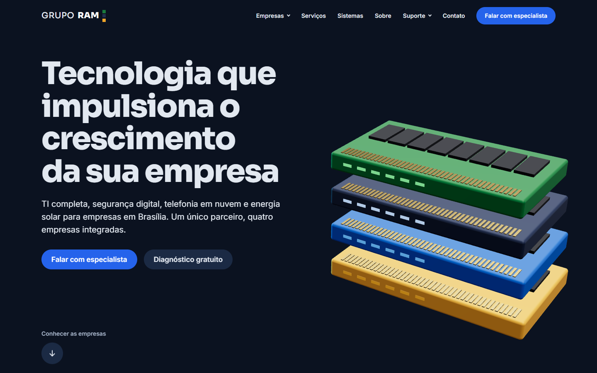
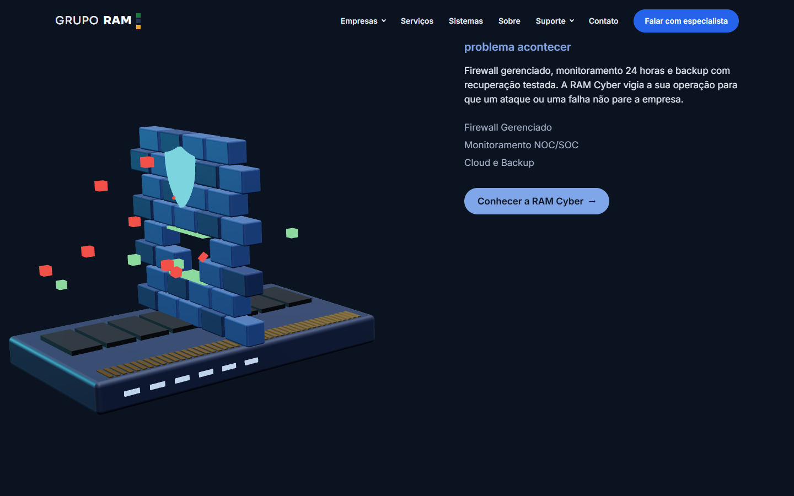
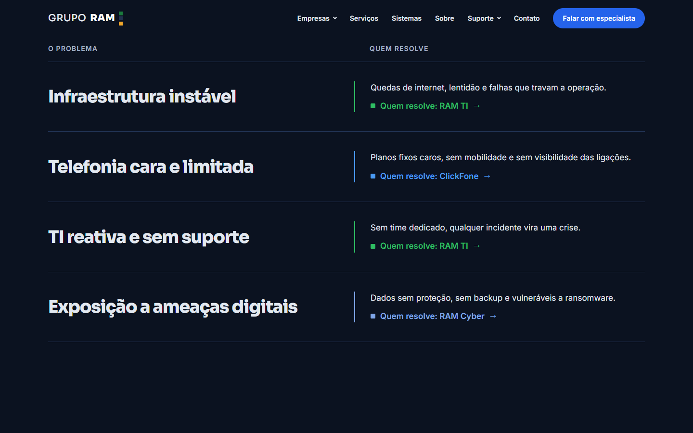
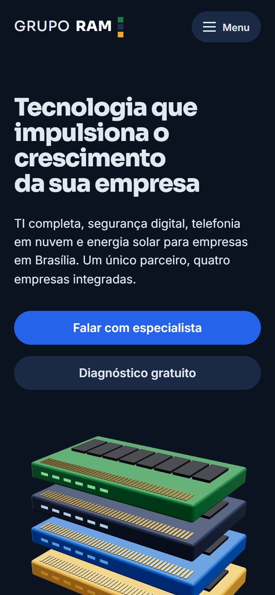

# Site do Grupo RAM

O site institucional do Grupo RAM, um grupo de Brasília com quatro empresas: RAM TI (suporte e infraestrutura), RAM Cyber (segurança digital), ClickFone (telefonia em nuvem) e RAM Solar (energia solar). Refeito sobre o sistema que já existia, com uma página para cada empresa, contato e política de privacidade.

**No ar:** [https://gruporam.com.br/](https://gruporam.com.br/)

## A ideia

O grupo vende quatro coisas bem diferentes, e o site junta as quatro numa imagem só: o nome é RAM, então a home é uma torre de quatro módulos de memória, um por empresa, cada um na cor da sua marca. Ao rolar a página, a torre se abre e destaca a empresa da vez. Na página de cada empresa, o módulo ganha o objeto do que ela faz: um rack para a RAM TI, um firewall barrando pacotes para a RAM Cyber, um telefone IP para a ClickFone e painéis com sol para a RAM Solar.

Quem chega com um problema não precisa saber qual empresa procura: a seção "Qual é o problema?" lista as dores mais comuns e leva direto para quem resolve.

  
  

## Como foi feito

- PHP 7.4 no servidor da empresa, com tema novo sobre o sistema que já existia (CoffeeCode Router e Plates). As URLs antigas redirecionam para as novas.
- Uma cena só em Three.js, carregada depois da primeira pintura, com rolagem suave (Lenis) e animações em GSAP. Sem WebGL ou com movimento reduzido, o site continua inteiro, sem a cena.
- No celular a cena vai para uma janela acima de cada bloco e monta pelo relógio, sem cobrir o texto.
- Acessibilidade com nota 100 no Lighthouse em todas as páginas e política de privacidade seguindo a LGPD.
- Fontes servidas do próprio site, sem passar pelo Google.

---

O código-fonte é privado. Este repositório é a apresentação do projeto, feito para o Grupo RAM, onde trabalho.

**Lucas de Oliveira Andrade**, [lucas-andrade.dev](https://lucas-andrade.dev)
